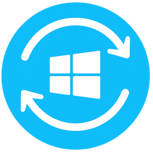
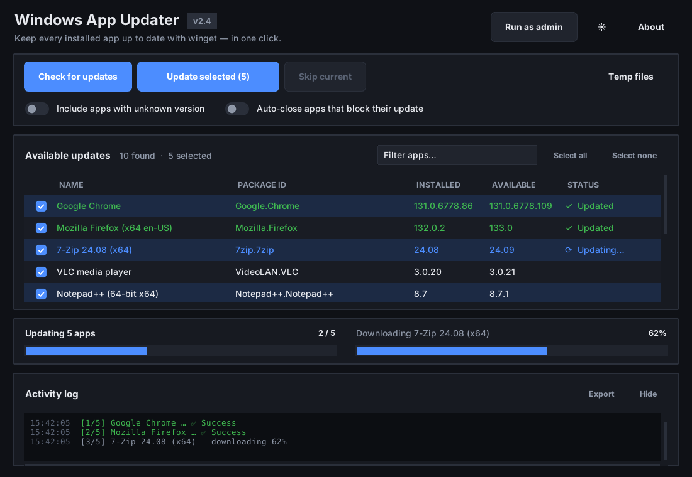
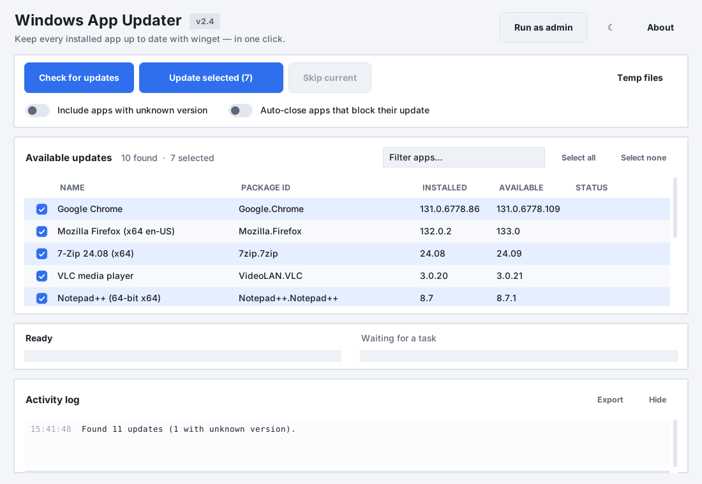
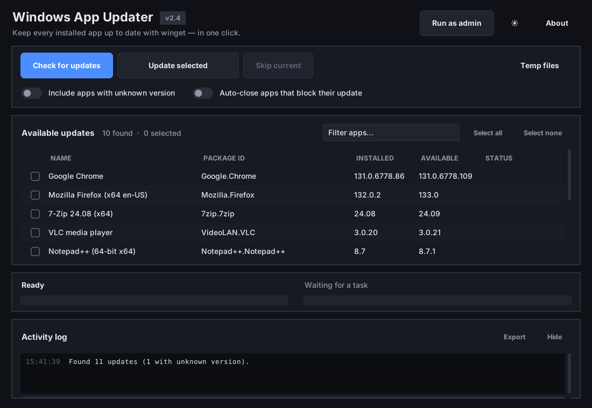

<p align="center">
  
</p>

<h1 align="center">Windows App Updater</h1>

<p align="center">
  <b>Keep every installed app up to date, in one click.</b><br>
  A free, modern front end for Microsoft's <code>winget</code>: see which apps have updates, tick the ones you want, and update them all at once.
</p>

<p align="center">
  <a href="../../releases/latest"></a>
  <a href="../../releases/latest"></a>
  
  <a href="LICENSE"></a>
  <a href="../../stargazers"></a>
</p>

<p align="center">
  <a href="https://github.com/ilukezippo/Windows-App-Updater/releases/download/v2.4/Windows-App-Updater-v2.4.exe"></a>
</p>

<p align="center">
  <sub>Downloads the latest version straight away: one .exe, nothing to install.</sub>
</p>

<p align="center">
  <a href="../../releases/latest">All downloads</a> ·
  <a href="#how-to-use">How to use</a> ·
  <a href="CHANGELOG.md">What's new</a> ·
  <a href="#features">Features</a> ·
  <a href="#build-from-source">Build</a>
</p>



<p align="center"><sub>If Windows App Updater saves you time, a ⭐ star on this page helps other people find it.</sub></p>

---

## Why

Windows apps each update themselves in their own way, or not at all. Microsoft's `winget` can update almost all of them, but only from the command line, and it gives you a wall of text, gets stuck on apps that are open, and doesn't tell you clearly what worked. Windows App Updater puts `winget` behind a clean window: one list of every available update, check boxes, real progress bars, and a clear result for each app.

## How to use

1. Run **Windows-App-Updater.exe** and click **Check for updates**.
2. Tick the apps you want to update (or **Select all**).
3. Click **Update selected**. Each app is downloaded and installed in turn, and its result appears in the **Status** column.

| Do this | You get |
|---|---|
| **Run as admin** | Installs apps that need administrator rights silently, without a UAC prompt for each one |
| **Skip current** | Stops the app that is updating right now and moves on to the next one |
| **Cancel** (Update selected becomes Cancel while updating) | Stops the whole batch |
| Type in **Filter apps…** | Only the apps whose name or package ID matches |
| Click a column heading | The list sorted by that column |
| Right-click an app | Show or delete its downloaded installer, copy its package ID |
| **Temp files** | Open winget's temporary folder, or clean out leftover installers |
| ☀ / ☾ | Switch between the light and dark theme |

<table>
  <tr>
    <td></td>
    <td></td>
  </tr>
  <tr>
    <td align="center">Light theme</td>
    <td align="center">Dark theme</td>
  </tr>
</table>

## What's new in 2.4

- **A new, modern look** with **light and dark themes**: it follows Windows' setting, and the ☀ / ☾ button switches between them
- Bug fixes across checking for and installing updates

Everything that changed is in the [changelog](CHANGELOG.md).

## Features

- **Every update in one list:** name, package ID, installed and available version, and a status for each app
- **Real progress:** an overall bar for the batch, and a per-app bar that shows the actual download percentage, then switches to *Installing*
- **Apps that are open:** when an app is running and blocks its own update, you're asked whether to close it (with *Remember my choice for this batch*), or turn on **Auto-close apps that block their update** for a hands-off run
- **Never gets stuck:** an app that shows no activity for 3 minutes is stopped and marked *Stalled*, and the batch carries on. Slow but active downloads are never cut off
- **Honest results:** each app is marked *Updated*, *Failed*, *Skipped*, *Canceled* or *Stalled* from winget's real exit code, not by guessing from its text
- **No fake updates:** apps whose "new" version is really the same one (like `2.4.0-release` vs `2.4.0`) are hidden
- **Unknown versions:** apps whose installed version winget can't detect are hidden by default; one switch shows them
- **Activity log** with timestamps, which you can hide or export to a file
- **Light and dark themes**, a success sound when everything worked, and it remembers your choices
- **Updates itself:** checks this GitHub page when it starts and offers to download the new version

## Install

1. **[Download Windows-App-Updater-v2.4.exe](https://github.com/ilukezippo/Windows-App-Updater/releases/download/v2.4/Windows-App-Updater-v2.4.exe)** (the latest version), or pick a file on the [Releases](../../releases/latest) page.
2. Run it. There's nothing to install: keep the .exe wherever you like.

> The .exe is not code-signed yet, so Windows may warn about it:
>
> - **Microsoft Edge** may hold the download ("isn't commonly downloaded"): open the downloads list, point at the file, choose **… → Keep**, then **Show more → Keep anyway**.
> - **SmartScreen** may warn when you run it: choose **More info → Run anyway**.

**Requirements:** Windows 10 or 11 with **winget**, which comes with Windows as *App Installer*. If it's missing, install **App Installer** from the Microsoft Store.

## Build from source

You need Python 3.12.

```bat
git clone https://github.com/ilukezippo/Windows-App-Updater.git
cd Windows-App-Updater
run.bat      :: first run creates a .venv, installs dependencies, starts the app
build.bat    :: builds dist\Windows-App-Updater.exe
```

To publish a release, set `APP_VERSION_ONLY` in `App-Updater.py`, add the version to [CHANGELOG.md](CHANGELOG.md), and push a tag like `v2.5`. GitHub Actions builds `Windows-App-Updater-v2.5.exe`, publishes the release with that version's changelog, and points the Download buttons on this page at it.

### Project layout

```
App-Updater.py        the whole app (Tkinter + Pillow)
windows-updater.ico   app icon
kuwait.png            flag shown in About
success.wav           sound played when every update succeeded
assets/, shots/       pictures for this page
```

## How it works

- **Checking:** runs `winget upgrade` (first the winget community source, then all sources, which adds Microsoft Store apps) and reads its table, even when names contain wide characters.
- **Updating:** runs `winget upgrade --id <package> --exact --silent` for each ticked app, one at a time, and follows winget's output to show download progress.
- **Results** come from winget's exit code, which tells *updated*, *no update needed*, *app in use* and real failures apart.
- **Skip and Cancel** stop winget *and* the installer it started, so nothing is left running in the background.
- **Self-update:** one request to `api.github.com/repos/ilukezippo/Windows-App-Updater/releases/latest` when it starts.
- Settings are kept in `%APPDATA%\WindowsAppUpdater\settings.json`. See the [privacy policy](PRIVACY.md).

## Known limits

- It can only update apps that winget knows about. Apps winget can't match show up with an *unknown* version, or not at all.
- Some installers ignore the *silent* switch and show their own window.
- Apps installed for one user can't always be updated from an administrator window, and the other way round.

## License

[MIT](LICENSE) © ilukezippo
